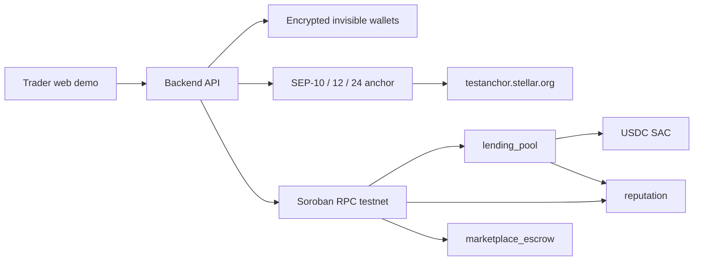

# Zao

Community-based micro-lending on **Stellar testnet** for unbanked traders in South Africa.

Groups of 3–5 people apply together. Every member signs the loan with their Stellar wallet. After all signatures, the lending pool pays **USDC** to the group leader. The term is **30 days**. Repayment is a single lump sum of **principal + 10%**. Repayment raises on-chain reputation; a default after day 30 lowers it.

Invisible wallets, SEP-10 / SEP-12 / SEP-24, and a KYC/AML gate live in the backend. Cash-out uses the configured anchor (`testanchor.stellar.org` by default; swap to Paychant or Yellow Card by changing `ANCHOR_HOME_DOMAIN`).

## Folder structure

```
zao_money/
├── contracts/
│   ├── reputation/           # on-chain score + history; only lending_pool may write
│   ├── lending_pool/         # groups, signatures, USDC disburse/repay/default, deposits
│   └── marketplace_escrow/   # fund, confirm, timeout refund, admin arbitration
├── wasm/                     # built contract bytecode
├── backend/                  # Node.js + TypeScript API, wallets, SEPs, jobs, scripts
├── client/                   # responsive web demo
├── config/testnet.json       # contract IDs written by deploy (created at runtime)
└── .env.example
```

## Contract interfaces

### `reputation`

| Function | Auth | Purpose |
|---|---|---|
| `initialize(admin)` | admin | One-time setup |
| `set_writer(writer)` | admin | Lending pool address is the only writer |
| `record_repayment(member, loan_id, amount)` | writer | +10 score |
| `record_default(member, loan_id)` | writer | −20 score |
| `get_score` / `get_record` / `get_history` | — | Reads |

### `lending_pool`

| Function | Auth | Purpose |
|---|---|---|
| `initialize(admin, usdc, reputation)` | admin | Bind USDC SAC + reputation contract |
| `create_group(leader, members[3..5])` | leader | Unique members, leader must be included |
| `request_loan(group, amount)` | leader | One active loan per group |
| `sign(group, member)` | member | Must be in the group; no double-sign |
| `disburse(group)` | — | All signatures required; USDC pool → leader |
| `repay(group, payer)` | payer | Pulls **exactly 110%** USDC back to the pool; +reputation |
| `mark_default(group)` | — | Only after `disbursed_at + 30 days`; −reputation |
| `deposit` / `withdraw` | lender | Pool liquidity |

USDC is the **Stellar Asset Contract** for a configurable issuer. Default Circle testnet USDC is `USDC:GBBD47IF6LWK7P7MDEVSCWR7DPUWV3NY3DTQEVFL4NAT4AQH3ZLLFLA5`. The e2e script mints a deployer-issued USDC SAC so the flow can run without Circle inventory; that issuer is written to `config/testnet.json`.

### `marketplace_escrow`

| Function | Auth | Purpose |
|---|---|---|
| `create_escrow(buyer, seller, amount)` | buyer | Open a trade |
| `fund(id)` | buyer | USDC into the contract, 7-day timeout |
| `confirm_delivery(id)` | buyer | Release to seller |
| `refund(id, caller)` | buyer after timeout, or seller anytime | Return to buyer |
| `dispute` / `arbitrate` | party / admin | Admin sends funds to seller or buyer |

## Architecture



## Setup

Prerequisites: Rust 1.84+ with `wasm32v1-none`, [Stellar CLI](https://developers.stellar.org/docs/tools/developer-tools/cli/install-cli), Node 22+.

```powershell
copy .env.example .env
# set WALLET_ENCRYPTION_KEY to 64 hex chars:
node -e "console.log(require('crypto').randomBytes(32).toString('hex'))"
```

```powershell
cargo test
stellar contract build
cd backend
npm install
npm test
npm run deploy          # writes config/testnet.json
npm run e2e             # live testnet flow + stellar.expert links
npm run dev             # API on :3001
```

```powershell
cd client
npm install
npm run dev             # demo on :5173, proxies /api to the backend
```

## Demo script (web)

1. Register three users (each gets a funded invisible testnet wallet).
2. Submit KYC for the leader (`Cash out` tab) and wait until status is `ACCEPTED`.
3. As the leader, create a group and invite the other two.
4. Request a loan. Sign in as each member and press **Sign**.
5. Disburse — blocked if KYC is not `ACCEPTED`.
6. Cash out via the anchor interactive URL (SEP-24).
7. Repay 110%. Read reputation for each member.

CLI equivalent: `cd backend && npm run e2e`.

Latest live testnet run (group 2, loan 2) — every hash is on [stellar.expert testnet](https://stellar.expert/explorer/testnet):

| Step | Transaction |
|---|---|
| mint USDC to lender | [`022919a0…`](https://stellar.expert/explorer/testnet/tx/022919a03cdd5817237368abfb077b432f53af62f2f7b8c1355515724c0335b4) |
| deposit into pool | [`ab919bf6…`](https://stellar.expert/explorer/testnet/tx/ab919bf6cc395782e26a02a80f1c0acdbb587c773816498caaf5a85af7284324) |
| create_group | [`f0b4db86…`](https://stellar.expert/explorer/testnet/tx/f0b4db86304aaef153113a055e4f90cb08cacfaf21965eadec31b09915a43d53) |
| request_loan 10 USDC | [`f346021b…`](https://stellar.expert/explorer/testnet/tx/f346021bee941b6b9798fa6983c70a55a6128cc5263dcae2511620a250ae21b2) |
| sign (leader) | [`0e9e4604…`](https://stellar.expert/explorer/testnet/tx/0e9e4604f9b064c6f7b0670bf7ae429ce50de4e9e99b062ab7fe56864b590206) |
| sign (member 2) | [`fb2ef83d…`](https://stellar.expert/explorer/testnet/tx/fb2ef83d78cfcc00f07f384131e7963fee21be6bca5bc8cf1d2ecf029cbc95f9) |
| sign (member 3) | [`23856935…`](https://stellar.expert/explorer/testnet/tx/23856935a86e0166f70f11239f92756c7ea27845cf98186760f61e2d7ddc5ff0) |
| disburse | [`885fc81b…`](https://stellar.expert/explorer/testnet/tx/885fc81bef24934a79bd2aee461f082f6de4359742e65901c896eeaf3d428fb7) |
| mint 10% for repay | [`46df4093…`](https://stellar.expert/explorer/testnet/tx/46df40933553a05619c93b7f398b7092edee8568b2b2aeb16dd3bc0259265bf9) |
| repay 110% | [`0a1a2628…`](https://stellar.expert/explorer/testnet/tx/0a1a262875b8b0782a7d4c0aa323cf3e1ba7888c120af547e698f57c2975b892) |

On-chain reputation after repay: **10** for each of the three members. SEP-12 returned `ACCEPTED`. SEP-24 created a live interactive withdraw (`type: interactive_customer_info_needed`); completing the hosted cash-out UI is a browser step and is not mocked.

## Testnet contract IDs

Last deploy (`2026-11-11T16:22:26Z`) wrote `config/testnet.json`:

| Contract | ID | Explorer |
|---|---|---|
| USDC SAC | `CDLW5RSVPQ3LJ7G4UJZWF65I34SNH7F7P5HTXNEP5UFFKOPIMLFNX7ZD` | [stellar.expert](https://stellar.expert/explorer/testnet/contract/CDLW5RSVPQ3LJ7G4UJZWF65I34SNH7F7P5HTXNEP5UFFKOPIMLFNX7ZD) |
| reputation | `CDLCQNL57LOB5LKZLCOTUOZ63CA46NPG3CJ2QJWQF6QYFLRFCEPZM6VF` | [stellar.expert](https://stellar.expert/explorer/testnet/contract/CDLCQNL57LOB5LKZLCOTUOZ63CA46NPG3CJ2QJWQF6QYFLRFCEPZM6VF) |
| lending_pool | `CAKX3TYTANV6IQIWFNRRIFWGBTBEKITJNUIBVPK73QMLG7IFUIHQFLYE` | [stellar.expert](https://stellar.expert/explorer/testnet/contract/CAKX3TYTANV6IQIWFNRRIFWGBTBEKITJNUIBVPK73QMLG7IFUIHQFLYE) |
| marketplace_escrow | `CCFXRSI6O3LB7JCE3HAVWFELMP5IWNV3QZIWVY7LLBQ5R575NRQMGFUZ` | [stellar.expert](https://stellar.expert/explorer/testnet/contract/CCFXRSI6O3LB7JCE3HAVWFELMP5IWNV3QZIWVY7LLBQ5R575NRQMGFUZ) |

Issuer for this deploy’s USDC SAC is the deployer `GAPY77FXSZ7VXK4KIF3L4MN6LBDIDMAPNH2BH76R5SZXGUBFQMAFFHFZ` (not Circle inventory). Redeploy with `cd backend && npm run deploy` to rotate IDs.

## KYC / AML gate

`POST /api/loans/:id/disburse` and `POST /api/anchor/withdraw` return **403** until SEP-12 reports `ACCEPTED` for that user. The contracts themselves do not enforce KYC; the API does.

A background job flags disbursed loans once `due_at` (day 30) is reached (`GET /api/loans/overdue`).

## Tests

- Contract unit tests: `cargo test` (missing signatures, wrong amount, late default, unauthorized writers, escrow timeout/arbitration).
- Wallet encryption + interest math: `cd backend && npm test`.

## What is unfinished

- **Flutter app** — the spec allowed a web demo instead; `stellar_flutter_sdk` is not in this MVP.
- **Hosted SEP-24 settlement** — the e2e script creates a real interactive withdraw with the live anchor and prints the URL. Completing the hosted UI (bank/mobile money details) needs a browser session; the script does not fake a completed cash-out.
- **Circle-issued USDC inventory** — e2e mints a deployer-issued USDC SAC so disbursement is a real testnet SAC transfer. Production config should point `USDC_ISSUER` at Circle’s testnet/mainnet issuer and pre-fund the pool.
- **`cargo test` on this Windows machine** — host-side contract tests exist (including missing signatures, insufficient 110% repayment, late default, unauthorized writers, escrow timeout/arbitration) and snapshot files from earlier runs are in `contracts/*/test_snapshots`. Recompiling them here is blocked by Windows Application Control (`os error 4551`) which refuses cargo build-script executables. Prebuilt WASM in `wasm/` is what was deployed. Re-run `cargo test` on a machine without that policy.
- **Deprecated Soroban events API** — contracts still use `env.events().publish`; SDK 23 prefers `#[contractevent]`. Behavior is unchanged.

## Contact

Project lead: Natasha Mumba — sintraworktools@gmail.com
