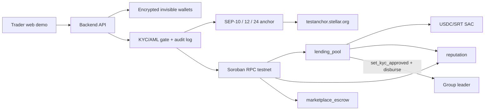

# Zao

Community-based micro-lending on **Stellar testnet** for unbanked traders in South Africa.

Groups of 3–5 people apply together. Every member signs the loan with their Stellar wallet. After all signatures, the lending pool pays **USDC** to the group leader. The term is **30 days**. Repayment is a single lump sum of **principal + 10%**. Repayment raises on-chain reputation; a default after day 30 lowers it.

Invisible wallets, SEP-10 / SEP-12 / SEP-24, and a KYC/AML gate live in the backend. Cash-out uses the configured anchor (`testanchor.stellar.org` by default; swap to Paychant or Yellow Card by changing `ANCHOR_HOME_DOMAIN`).

## Folder structure

```
zao_money/
├── contracts/
│   ├── reputation/           # on-chain score + history; only lending_pool may write
│   ├── lending_pool/         # groups, signatures, USDC disburse/repay/default, deposits
│   └── marketplace_escrow/   # fund, confirm, timeout refund, admin arbitration
├── wasm/                     # built contract bytecode
├── backend/                  # Node.js + TypeScript API, wallets, SEPs, jobs, scripts
├── client/                   # responsive web demo
├── supabase/migrations/      # hosted Postgres schema (users, sessions, groups, loans, escrows, anchor_txs)
├── config/testnet.json       # contract IDs written by deploy (created at runtime)
└── .env.example
```

## Contract overview (Deliverable 1)

Three Soroban contracts in `contracts/`. Optimized WASM lives in `wasm/` (sizes and SHA-256 hashes in `wasm/README.md`). Every state change emits a `#[contractevent]`. User-facing inputs return `Error` enums — no `unwrap` on contract arguments.

### `reputation`

Only the lending pool (the configured **writer**) may write scores.

| Function | Auth | Purpose |
|---|---|---|
| `initialize(admin)` | admin | One-time setup |
| `set_writer(writer)` | admin | Lending pool address is the only writer |
| `record_repayment(member, loan_id, amount)` | writer | +10 score |
| `record_default(member, loan_id)` | writer | −20 score |
| `get_score` / `get_record` / `get_history` / `get_admin` / `get_writer` | — | Reads |

### `lending_pool`

USDC is the **Stellar Asset Contract** address passed to `initialize` (configurable issuer). Default Circle testnet USDC is `USDC:GBBD47IF6LWK7P7MDEVSCWR7DPUWV3NY3DTQEVFL4NAT4AQH3ZLLFLA5`. Groups are 3–5 unique members. Loan term is **30 days**. Repayment is a single lump sum of **principal + 10%**. `disburse` requires every member signature **and** an on-chain KYC flag for the leader (`set_kyc_approved`).

| Function | Auth | Purpose |
|---|---|---|
| `initialize(admin, usdc, reputation)` | admin | Bind USDC SAC + reputation contract |
| `set_kyc_approved(admin, account, approved)` | admin | On-chain KYC flag used at disburse (Deliverable 3 wiring) |
| `is_kyc_approved(account)` | — | Read KYC flag |
| `create_group(leader, members[3..5])` | leader | Unique members; leader must be included |
| `request_loan(group, amount)` | leader | One active loan per group |
| `sign(group, member)` | member | Must be in the group; no double-sign |
| `disburse(group)` | — | All signatures + leader KYC; USDC pool → leader; `due_at = now + 30d` |
| `repay(group, payer)` | payer | Pulls **exactly 110%** before due; marks repaid; +reputation |
| `mark_default(group)` | — | Only after `due_at` if unpaid; −reputation |
| `deposit` / `withdraw` | lender | Pool liquidity |
| `get_group` / `get_loan` / `get_group_loan` / `get_due_amount` / `get_deposit` / `get_usdc` / `get_reputation` | — | Reads |

### `marketplace_escrow`

Buyer USDC is held in the contract until release, timeout refund, or admin arbitration.

| Function | Auth | Purpose |
|---|---|---|
| `initialize(admin, usdc)` | admin | Bind admin + USDC SAC |
| `create_escrow(buyer, seller, amount)` | buyer | Open a trade |
| `fund(id)` | buyer | USDC into the contract, 7-day timeout |
| `mark_shipped(id)` | seller | Funded → Shipped |
| `confirm_delivery(id)` | buyer | From Funded or Shipped; release to seller |
| `refund(id, caller)` | buyer after timeout (Funded/Shipped), or seller while Funded | Return to buyer |
| `dispute(id, caller)` | buyer or seller | From Funded or Shipped |
| `arbitrate(id, release_to_seller)` | admin | After dispute; send funds to seller or buyer |
| `get_escrow` / `get_admin` | — | Reads |

## Build and test (contracts)

Prerequisites: Rust 1.84+ with target `wasm32v1-none`, [Stellar CLI](https://developers.stellar.org/docs/tools/developer-tools/cli/install-cli).

```powershell
# Unit tests for the whole workspace (lending_pool, marketplace_escrow, reputation)
cargo test

# Optimized WASM for each contract
stellar contract build
stellar contract optimize --wasm target/wasm32v1-none/release/lending_pool.wasm --wasm-out wasm/lending_pool.wasm
stellar contract optimize --wasm target/wasm32v1-none/release/marketplace_escrow.wasm --wasm-out wasm/marketplace_escrow.wasm
stellar contract optimize --wasm target/wasm32v1-none/release/reputation.wasm --wasm-out wasm/reputation.wasm
```

Hashes and sizes of the committed artifacts are in [`wasm/README.md`](wasm/README.md).

## Architecture



Disburse is gated twice:

1. **Off-chain** — `POST /api/loans/:groupId/disburse` requires SEP-12 `ACCEPTED`, then AML (max amount + denylist). Every decision is written to `gate_audit`.
2. **On-chain** — after ACCEPTED, the admin calls `lending_pool.set_kyc_approved(leader, true)`. The contract still rejects `disburse` with `KycRequired` (#22) if that flag is missing.

## Setup

Prerequisites: Rust 1.84+ with `wasm32v1-none`, [Stellar CLI](https://developers.stellar.org/docs/tools/developer-tools/cli/install-cli), Node 22+.

```powershell
copy .env.example .env
# set WALLET_ENCRYPTION_KEY to 64 hex chars:
node -e "console.log(require('crypto').randomBytes(32).toString('hex'))"
# optional: paste DATABASE_URL from the Supabase project (ktqukwdgsfjdhvenydmd)
# so the API uses hosted Postgres instead of local SQLite
```

```powershell
cargo test
stellar contract build
cd backend
npm install
npx playwright install chromium
npm test
npm run deploy:testnet  # deploys wasm/ to testnet, writes config/testnet.json
npm run demo:payout     # Deliverable 2: group → disburse → SEP-24 payment to the anchor
npm run demo:kyc        # Deliverable 3: blocked KYC → ACCEPTED → disburse → cash-out
npm run dev             # API on :3001
```

### Deliverable 2 — testnet anchor payout

The lending pool is initialized with the **SRT/USDC credit asset advertised in the anchor `stellar.toml`** (default `testanchor.stellar.org`, asset `SRT`). Accounts are funded with Friendbot and receive trustlines automatically.

```powershell
cd backend
npm run deploy:testnet
npm run demo:payout
```

`demo:payout` creates a 3-member group, has every member sign, calls `set_kyc_approved` for the leader, disburses, starts a SEP-24 withdraw, drives the hosted page with Playwright, pays the anchor’s `withdraw_anchor_account` with the required memo, and writes hashes to `evidence/deliverable2.md`.

API:

- `POST /api/anchor/withdraw` `{ "amount": "2" }` — SEP-10 + SEP-24 interactive withdraw; returns `{ id, url }`
- `GET /api/anchor/transactions/:id` — poll SEP-24 status
- `POST /api/anchor/withdraw/:id/pay` — once status is `pending_user_transfer_start`, submit the Stellar payment and poll until `completed`

Secrets stay in `.env` (see `.env.example`). Logs never print Stellar secrets or JWTs.

```powershell
cd client
npm install
npm run dev             # demo on :5173, proxies /api to the backend
```

## Demo script (web)

1. **Try the demo** (Thabo, Lerato, Sipho — each gets a funded invisible testnet wallet).
2. Form a group of 3. Request a loan (default 2). **Everyone signs**.
3. **KYC & pay**: disburse is disabled with the gate reason while status is `NEEDS_INFO`.
4. Submit the KYC form. When the anchor reports `ACCEPTED`, the backend calls `set_kyc_approved`.
5. **Disburse** — stellar.expert link on success.
6. **Cash out** via the SEP-24 interactive URL.

Screen-recording narration: [`evidence/demo-script.md`](evidence/demo-script.md). CLI: `cd backend && npm run demo:kyc`.

Latest live testnet run (group 2, loan 2) — every hash is on [stellar.expert testnet](https://stellar.expert/explorer/testnet):

| Step | Transaction |
|---|---|
| mint USDC to lender | [`022919a0…`](https://stellar.expert/explorer/testnet/tx/022919a03cdd5817237368abfb077b432f53af62f2f7b8c1355515724c0335b4) |
| deposit into pool | [`ab919bf6…`](https://stellar.expert/explorer/testnet/tx/ab919bf6cc395782e26a02a80f1c0acdbb587c773816498caaf5a85af7284324) |
| create_group | [`f0b4db86…`](https://stellar.expert/explorer/testnet/tx/f0b4db86304aaef153113a055e4f90cb08cacfaf21965eadec31b09915a43d53) |
| request_loan 10 USDC | [`f346021b…`](https://stellar.expert/explorer/testnet/tx/f346021bee941b6b9798fa6983c70a55a6128cc5263dcae2511620a250ae21b2) |
| sign (leader) | [`0e9e4604…`](https://stellar.expert/explorer/testnet/tx/0e9e4604f9b064c6f7b0670bf7ae429ce50de4e9e99b062ab7fe56864b590206) |
| sign (member 2) | [`fb2ef83d…`](https://stellar.expert/explorer/testnet/tx/fb2ef83d78cfcc00f07f384131e7963fee21be6bca5bc8cf1d2ecf029cbc95f9) |
| sign (member 3) | [`23856935…`](https://stellar.expert/explorer/testnet/tx/23856935a86e0166f70f11239f92756c7ea27845cf98186760f61e2d7ddc5ff0) |
| disburse | [`885fc81b…`](https://stellar.expert/explorer/testnet/tx/885fc81bef24934a79bd2aee461f082f6de4359742e65901c896eeaf3d428fb7) |
| mint 10% for repay | [`46df4093…`](https://stellar.expert/explorer/testnet/tx/46df40933553a05619c93b7f398b7092edee8568b2b2aeb16dd3bc0259265bf9) |
| repay 110% | [`0a1a2628…`](https://stellar.expert/explorer/testnet/tx/0a1a262875b8b0782a7d4c0aa323cf3e1ba7888c120af547e698f57c2975b892) |

On-chain reputation after repay: **10** for each of the three members. SEP-12 returned `ACCEPTED`. SEP-24 created a live interactive withdraw (`type: interactive_customer_info_needed`); completing the hosted cash-out UI is a browser step and is not mocked.

## Testnet contract IDs

Last deploy (`2026-11-12T06:50:12Z`) wrote `config/testnet.json`. Pool asset is testanchor **SRT** (`GCDNJUBQSX7AJWLJACMJ7I4BC3Z47BQUTMHEICZLE6MU4KQBRYG5JY6B`).

| Contract | ID | Explorer |
|---|---|---|
| SRT SAC | `CBZVLMD5DBKIFSVU23WAVMJD25IRUBWCVAXGURPUPMB2CUNFBQN742UV` | [stellar.expert](https://stellar.expert/explorer/testnet/contract/CBZVLMD5DBKIFSVU23WAVMJD25IRUBWCVAXGURPUPMB2CUNFBQN742UV) |
| reputation | `CCIIUDB47LYE6HJCRURMFJ4XOU7XARE2LSSPZOJNQA2IEZMY7E6DW2RE` | [stellar.expert](https://stellar.expert/explorer/testnet/contract/CCIIUDB47LYE6HJCRURMFJ4XOU7XARE2LSSPZOJNQA2IEZMY7E6DW2RE) |
| lending_pool | `CBZGLCLXSEEYN44RKFIW5KDGTSCV4X5TW5DRJKRF5UXV5VPKPD4UZAEX` | [stellar.expert](https://stellar.expert/explorer/testnet/contract/CBZGLCLXSEEYN44RKFIW5KDGTSCV4X5TW5DRJKRF5UXV5VPKPD4UZAEX) |
| marketplace_escrow | `CDOASBD2VSNG3SO6SF4OQHVGLY3EAA57JQHF34U4DW3MAMJB6UNUZMMQ` | [stellar.expert](https://stellar.expert/explorer/testnet/contract/CDOASBD2VSNG3SO6SF4OQHVGLY3EAA57JQHF34U4DW3MAMJB6UNUZMMQ) |

## Evidence

| Deliverable | Proof |
|---|---|
| 1. Contracts | 56 host tests; optimized wasm in [`wasm/`](wasm/); [`wasm/README.md`](wasm/README.md) |
| 2. SEP-24 payout | [`evidence/deliverable2.md`](evidence/deliverable2.md) — payment [`82149e84…`](https://stellar.expert/explorer/testnet/tx/82149e84e87c3b09b38339863bcee656597e351d1d195d819f52e1c81dce3e5f) |
| 3. KYC/AML gate | [`evidence/deliverable3.md`](evidence/deliverable3.md), screenshots `evidence/screenshots/d3-*.png`, script [`evidence/demo-script.md`](evidence/demo-script.md) — blocked `#22 KycRequired` + API 403 `NEEDS_INFO`, then allowed disburse [`6bac3ff0…`](https://stellar.expert/explorer/testnet/tx/6bac3ff00e516b453992d99cbfebdd3134d99f0312ee273f8a887f9332989a95) |

## KYC / AML gate (Deliverable 3)

SEP-12 against `ANCHOR_HOME_DOMAIN` (default testanchor): `PUT /customer`, `GET /customer` (`NEEDS_INFO`, `PROCESSING`, `ACCEPTED`, `REJECTED`).

`POST /api/loans/:groupId/disburse` allows only **ACCEPTED**, then AML:

- `AML_MAX_AMOUNT` (human units, default `1000`)
- `AML_DENYLIST` (comma-separated `G…` keys)

On ACCEPTED the admin invokes `set_kyc_approved(leader, true)` so the contract check passes. Decisions are stored in `gate_audit` (who, status, allowed/blocked, time, reason).

`GET /api/loans/:groupId/gate` drives the disabled Disburse button in the web demo.

Live testnet run (group 7, `npm run demo:kyc`, 2026-11-12):

| Step | Result |
|---|---|
| On-chain `disburse` before KYC | live simulation **Contract error #22 (KycRequired)** |
| API `POST /loans/:id/disburse` | **403** `NEEDS_INFO` |
| `set_kyc_approved` | [`29263511…`](https://stellar.expert/explorer/testnet/tx/2926351161c958950ac8bdead0d6e5c61538d3c3e7c8f2f177aadcd7613847ab) |
| Allowed `disburse` | [`6bac3ff0…`](https://stellar.expert/explorer/testnet/tx/6bac3ff00e516b453992d99cbfebdd3134d99f0312ee273f8a887f9332989a95) |
| SEP-24 cash-out | `e0b284e7-…` **completed**; payment [`2e527501…`](https://stellar.expert/explorer/testnet/tx/2e527501757cd8fbaa42561f453ab27691231fa1f60ee7b12647b0c1e01e25cd) |

A background job flags disbursed loans once `due_at` (day 30) is reached (`GET /api/loans/overdue`).

## Database (Supabase)

Hosted project: [`ktqukwdgsfjdhvenydmd`](https://ktqukwdgsfjdhvenydmd.supabase.co) (`users`, `sessions`, `groups`, `loans`, `escrows`, `anchor_txs`). RLS is on and `anon`/`authenticated` have no grants — encrypted wallet secrets stay off the Data API. The backend uses `DATABASE_URL` (service connection). Unit tests keep using local SQLite.

```powershell
# Project Settings → Database → URI (session mode or pooler)
# paste into .env as DATABASE_URL=postgresql://...
cd backend
npm run dev   # health JSON includes `"db": "postgres"` once DATABASE_URL is set
```

## Tests

- Contract unit tests: `cargo test` — every public function, including failure cases (wrong group size, missing signature, double disburse, wrong repay amount, late repay, unauthorized callers, KYC gate, escrow timeouts, disputes, `mark_shipped`).
- Wallet encryption, interest math, SEP-10 signing, SEP-24 poll/payment builders, KYC/AML gate: `cd backend && npm test` (HTTP is mocked in unit tests).
- On-chain KYC rejection: `disburse_fails_without_leader_kyc` in `contracts/lending_pool` (`cargo test -p lending_pool`).

## What is unfinished

- **Flutter app** — the spec allowed a web demo instead; `stellar_flutter_sdk` is not in this MVP.

## Contact

Project lead: Natasha Mumba — sintraworktools@gmail.com
